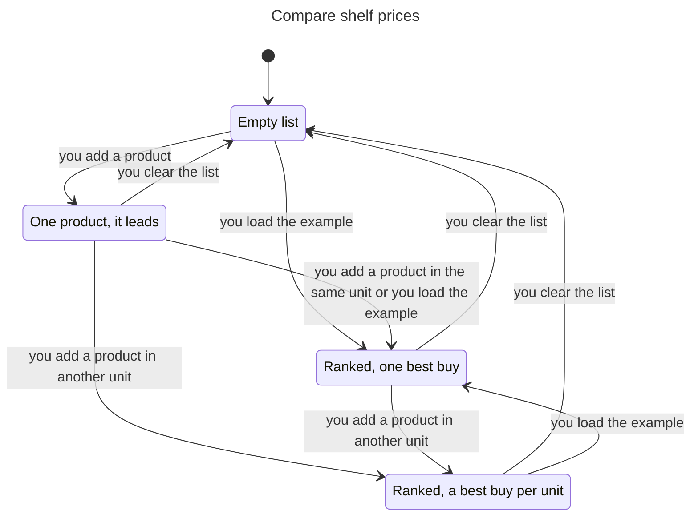

# Price ranking verification

| Skill | What it checks | Tool |
| --- | --- | --- |
| [verify-price-ranking](../../.claude/skills/verify-price-ranking/SKILL.md) | Each unit and currency gets one best buy, the cheapest comparable product | 2,000 generated lists per run against `calculator.js` |

Fixed along the way:

1. Products in different units or currencies were ranked against each other, so the page crowned a coffee priced per gram over toilet paper priced per meter.
2. One damaged saved item emptied the whole list on the next load.

## Compare shelf prices

Generated with pstack `/statechart` from [ComparePrices.tla](flows/compare-prices/ComparePrices.tla) ([TLC report](flows/compare-prices/report.md)).

